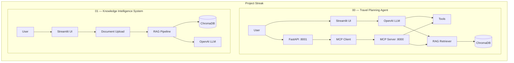

# Project Streak

A collection of beginner-to-intermediate Generative AI projects built while learning RAG, agents, and tool-calling.

## Projects

| # | Project | Description | Stack |
|---|---------|-------------|-------|
| 00 | [Travel Planning Agent](./projects/00-travel-planning-agent) | Preference gathering + tools + RAG for grounded itinerary advice. Dual path: direct Streamlit and MCP-backed FastAPI. | Streamlit, FastAPI, MCP, OpenAI, ChromaDB |
| 01 | [Knowledge Intelligence System](./projects/01-knowledge-intelligence-system) | Upload PDFs/TXT and chat with them using RAG. | Streamlit, LangChain, ChromaDB, OpenAI |

## Architecture Overview



## Project Structure

```
.
├── README.md
├── .gitignore
├── .env.example
└── projects/
    ├── 00-travel-planning-agent/      # RAG + MCP + FastAPI travel agent
    │   ├── app.py
    │   ├── backend.py
    │   ├── mcp_server.py
    │   ├── tools.py
    │   ├── llm.py
    │   ├── models.py
    │   ├── rag/
    │   ├── knowledge/
    │   ├── requirements.txt
    │   └── README.md
    └── 01-knowledge-intelligence-system/   # Document Q&A RAG
        ├── app.py
        ├── requirements.txt
        └── README.md
```

## Author

Yash Paprikar  
[GitHub](https://github.com/yash9614)
