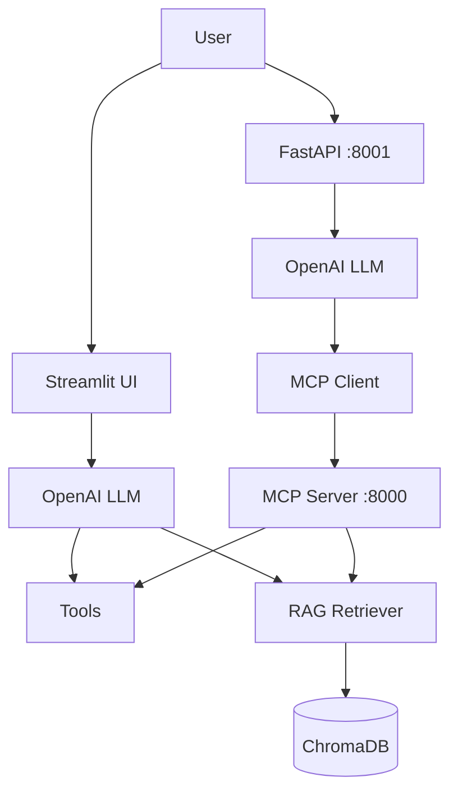

# Project Streak — Travel Planning Agent (RAG + MCP + FastAPI)

A travel assistant that gathers preferences, calls tools, and retrieves destination knowledge to produce grounded itinerary advice.

## Problem

Users want quick, accurate travel help (dates, rough costs, destination tips) without searching multiple sites. This agent combines structured tools with a small knowledge base so answers are both actionable and grounded.

## Stack

| Layer | Choice |
|-------|--------|
| UI | Streamlit |
| LLM | OpenAI (`gpt-4o-mini`) |
| Embeddings | `text-embedding-3-small` |
| Vector DB | ChromaDB (persistent local) |
| MCP | MCP 2.x (streamable HTTP) |
| Backend | FastAPI + Uvicorn |
| Config | `python-dotenv` |

## Architecture



**Two paths (deliberate):**
- Streamlit calls tools and RAG directly for fast local iteration.
- FastAPI goes through the MCP server so the same tools can be reused by other clients.

## Design decisions and tradeoffs

- **MCP between FastAPI and tools** — keeps tool definitions in one place and makes the agent callable from any MCP client later.
- **Streamlit bypasses MCP** — simpler for local development; the tool implementations stay identical.
- **ChromaDB local** — zero infra for demos; swap for Qdrant/Pinecone later without changing retrieval code.
- **Stateless `/chat`** — client sends history; no server-side session store yet.
- **Simple chunking** — one document per file; easy to extend with overlap later.

## Example

**Request**
```json
{"message": "What is today date and any Kyoto tips?"}
```

**Response**
```json
{
  "reply": "Today's date is Saturday, 31 October 2026. For Kyoto: visit temples early morning to avoid crowds, and note that many restaurants close 3-5 PM.",
  "tool_calls": ["get_current_date_tool", "search_knowledge_base_tool"]
}
```

## Project Structure

```
.
├── app.py                  # Streamlit UI (direct tools + RAG)
├── backend.py              # FastAPI (MCP client)
├── mcp_server.py           # MCP server (streamable HTTP)
├── tools.py                # Shared tool implementations
├── rag/
│   ├── vectorstore.py
│   ├── ingestion.py
│   └── retriever.py
├── knowledge/
│   └── sample-faq.md
├── docs/
│   └── concepts.md         # Design notes + interview questions
├── requirements.txt
├── .env.example
└── README.md
```

## Quick Start

```bash
# Windows (PowerShell)
uv venv
.\.venv\Scripts\Activate.ps1
uv pip install -r requirements.txt
copy .env.example .env

# macOS / Linux
uv venv
source .venv/bin/activate
uv pip install -r requirements.txt
cp .env.example .env
```

Edit `.env` and set `OPENAI_API_KEY` (also used as `CHROMA_OPENAI_API_KEY`).

```bash
# Terminal 1
python mcp_server.py

# Terminal 2
uvicorn backend:app --reload --port 8001

# Terminal 3 (optional)
streamlit run app.py
```

## Test

```bash
# PowerShell
irm -Method Post -Uri "http://127.0.0.1:8001/chat" -ContentType "application/json" -Body '{"message": "What is today date and any Kyoto tips?"}'

# curl
curl -X POST http://127.0.0.1:8001/chat \
  -H "Content-Type: application/json" \
  -d '{"message": "What is today date and any Kyoto tips?"}'
```

## Notes

- Retrieval: top-k=3, one chunk per file, sources returned in tool output.
- `/chat` is stateless; pass history if needed.
- No auth, logging, or Docker yet (easy next steps).

## Author

Yash Paprikar  
[GitHub](https://github.com/yash9614)
