# Project Streak

A collection of beginner-to-intermediate Generative AI projects built while learning RAG, agents, tool-calling, structured outputs, and full-stack LLM applications.

## Projects

| # | Project | Description | Stack |
|---|---------|-------------|-------|
| 00 | [Travel Planning Agent](./projects/00-travel-planning-agent) | Preference gathering + tools + RAG for grounded itinerary advice. Dual path: direct Streamlit and MCP-backed FastAPI. | Streamlit, FastAPI, MCP, OpenAI, ChromaDB |
| 01 | [Knowledge Intelligence System](./projects/01-knowledge-intelligence-system) | Upload PDFs/TXT and chat with them using RAG. | Streamlit, LangChain, ChromaDB, OpenAI |
| 02 | [E-commerce Assistant](./projects/02-ecommerce-assistant) | Multi-route chatbot: small-talk, FAQ RAG, and text-to-SQL product queries. | Streamlit, OpenAI, semantic-router, ChromaDB, SQLite |
| 03 | [Customer Feedback Analyzer](./projects/03-customer-feedback-analyzer) | Batch analyze customer reviews with structured outputs (label, score, theme). FastAPI backend + Streamlit dashboard + SQLite history. | Streamlit, FastAPI, OpenAI (structured outputs), Pydantic, SQLite |

## Architecture Overview

```mermaid
flowchart TB
    subgraph Repo["Project Streak"]
        direction TB

        subgraph Travel["00 — Travel Planning Agent"]
            U1[User] --> S1[Streamlit UI]
            U1 --> F1[FastAPI :8001]
            S1 --> L1[OpenAI LLM]
            F1 --> MC[MCP Client]
            MC --> MS[MCP Server :8000]
            L1 --> T1[Tools]
            L1 --> R1[RAG Retriever]
            MS --> T1
            MS --> R1
            R1 --> C1[(ChromaDB)]
        end

        subgraph KIS["01 — Knowledge Intelligence System"]
            U2[User] --> S2[Streamlit UI]
            S2 --> Up[Document Upload]
            Up --> R2[RAG Pipeline]
            R2 --> C2[(ChromaDB)]
            R2 --> L2[OpenAI LLM]
        end

        subgraph Ecom["02 — E-commerce Assistant"]
            U3[User] --> S3[Streamlit Chat]
            S3 --> Router[Semantic Router]
            Router -->|small-talk| ST[Small-talk Handler]
            Router -->|faq| FAQ[FAQ RAG]
            Router -->|sql| SQL[Text-to-SQL]
            FAQ --> C3[(ChromaDB)]
            SQL --> DB[(SQLite)]
            ST --> L3[OpenAI]
            FAQ --> L3
            SQL --> L3
        end

        subgraph Feedback["03 — Customer Feedback Analyzer"]
            U4[User] --> S4[Streamlit Dashboard]
            S4 -->|POST /analyze| F4[FastAPI Backend]
            F4 --> OAI[OpenAI Structured Outputs]
            OAI --> F4
            F4 --> S4
            S4 --> DB4[(SQLite feedback.db)]
        end
    end
```



## Project Structure

```
.
├── README.md
├── .gitignore
├── .env.example
└── projects/
    ├── 00-travel-planning-agent/      # RAG + MCP + FastAPI travel agent
    │   ├── app.py
    │   ├── backend.py
    │   ├── mcp_server.py
    │   ├── tools.py
    │   ├── llm.py
    │   ├── models.py
    │   ├── rag/
    │   ├── knowledge/
    │   ├── requirements.txt
    │   └── README.md
    ├── 01-knowledge-intelligence-system/   # Document Q&A RAG
    │   ├── app.py
    │   ├── requirements.txt
    │   └── README.md
    ├── 02-ecommerce-assistant/          # Multi-route chatbot (FAQ + SQL + small-talk)
    │   ├── app/
    │   │   ├── main.py
    │   │   ├── ask.py
    │   │   ├── router.py
    │   │   ├── faq.py
    │   │   ├── sql.py
    │   │   └── smalltalk.py
    │   ├── requirements.txt
    │   └── README.md
    └── 03-customer-feedback-analyzer/   # Structured review analysis + dashboard
        ├── api.py                      # FastAPI backend (OpenAI structured outputs)
        ├── app.py                      # Streamlit frontend
        ├── database.py                 # SQLite helpers
        ├── sample_reviews.txt
        ├── .env.example
        ├── templates.py
        └── README.md                   # (optional)
```

## Key Concepts Demonstrated

| Concept | Where it appears |
|---------|------------------|
| **RAG** (retrieval-augmented generation) | 00, 01, 02 |
| **Tool calling / function calling** | 00 |
| **MCP** (Model Context Protocol) | 00 |
| **Semantic routing** | 02 |
| **Text-to-SQL** | 02 |
| **Structured outputs** (Pydantic + OpenAI) | 03 |
| **Full-stack LLM app** (FastAPI + Streamlit) | 00, 03 |
| **Persistent storage** (SQLite) | 02, 03 |

## Author

Yash Paprikar  
[GitHub](https://github.com/yash9614)
