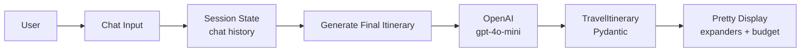
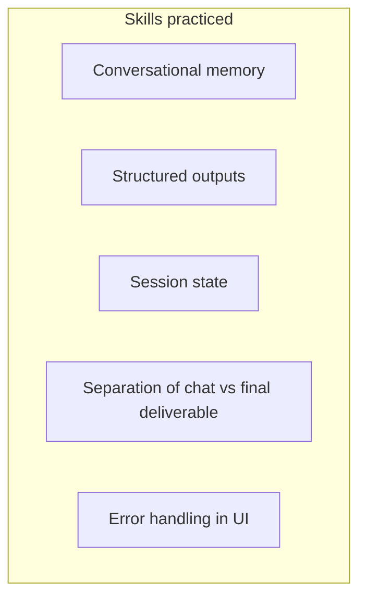

# Project Streak — AI Travel Assistant

A Streamlit chat app that gathers travel preferences conversationally, then generates a structured day-by-day itinerary on demand.

Built as a practical GenAI project: conversational memory + Pydantic structured outputs + clean UI.

## Stack

| Layer | Choice |
|-------|--------|
| UI | Streamlit |
| LLM | OpenAI (`gpt-4o-mini`) |
| Structured output | Pydantic + OpenAI `.parse()` |
| Config | `python-dotenv` |

## How it works

1. User chats freely (destination, days, budget, interests).
2. Chat history is kept in Streamlit session state.
3. When ready, user clicks **Generate Final Itinerary**.
4. The full transcript is sent once and returned as a typed `TravelItinerary`.
5. Results are rendered as expanders, not raw JSON.





## Project structure

```
.
├── app.py              # Streamlit UI + chat + button
├── llm.py              # OpenAI client + structured generation
├── models.py           # Pydantic schemas
├── requirements.txt
├── .env.example
└── README.md
```

## Quick start

```bash
# Activate your existing venv (or create one)
# Then:
uv pip install -r requirements.txt

# Copy and edit
copy .env.example .env
# Add your OPENAI_API_KEY

streamlit run app.py
```

## Example conversation

```
User: I want a 4-day trip to Kyoto in November. Love temples and food. Budget around $1500.
Assistant: Great. Any must-see places or dietary preferences?
User: No dietary restrictions. Prefer quieter spots in the evenings.
[Click Generate Final Itinerary]
```

## Schema

| Model | Fields |
|-------|--------|
| `Activity` | time, title, description, estimated_cost_usd |
| `DayPlan` | day, title, activities |
| `TravelItinerary` | destination, duration_days, total_estimated_budget_usd, summary, days, tips |

## Why this design

- Chat stays cheap and fast.
- Structured generation runs only when the user is ready.
- Output is typed and easy to render or export later.
- Easy to extend (weather tool, budget loop, multi-agent, PDF export).

## Author

Yash Paprikar  
[GitHub](https://github.com/yash9614)
