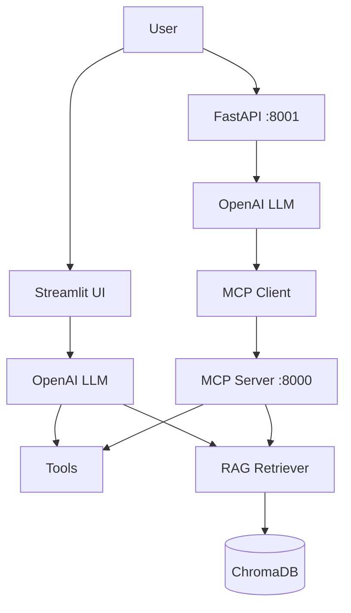

# Travel Planning Agent (RAG + MCP + FastAPI)

A travel assistant that gathers preferences, calls tools, and retrieves destination knowledge to produce grounded itinerary advice.

## Stack

| Layer | Choice |
|-------|--------|
| UI | Streamlit |
| LLM | OpenAI (`gpt-4o-mini`) |
| Embeddings | `text-embedding-3-small` |
| Vector DB | ChromaDB (persistent local) |
| MCP | MCP 2.x (streamable HTTP) |
| Backend | FastAPI + Uvicorn |

## Architecture



**Two paths (deliberate):**
- Streamlit calls tools and RAG directly for fast local iteration.
- FastAPI goes through the MCP server so the same tools can be reused by other clients.

## Quick Start

```bash
cd projects/00-travel-planning-agent
pip install -r requirements.txt
cp .env.example .env   # add your OPENAI_API_KEY

# Terminal 1
python mcp_server.py

# Terminal 2
uvicorn backend:app --reload --port 8001

# Terminal 3 (optional)
streamlit run app.py
```

## Notes

- Retrieval uses top-k=3 with one chunk per knowledge file.
- `/chat` is stateless; pass history from the client if needed.
